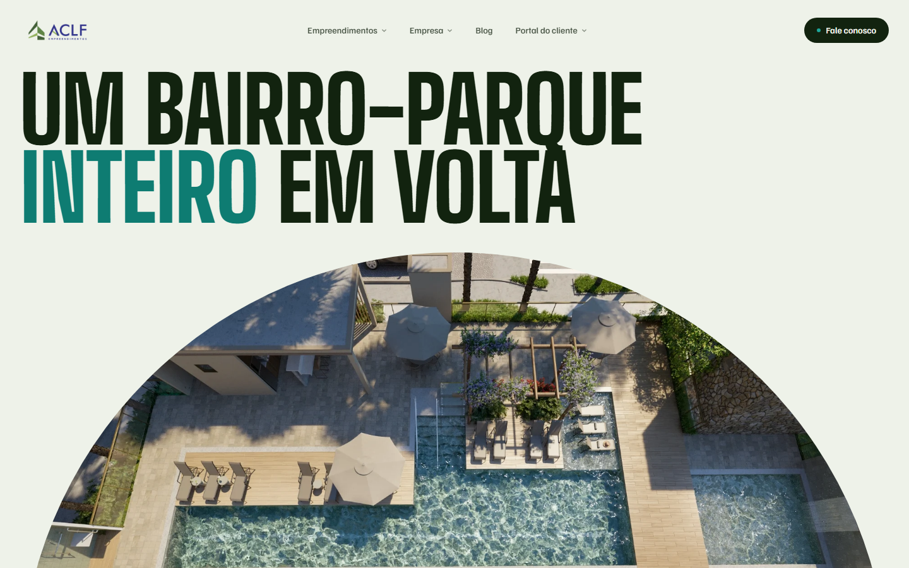

# Realty Showcase

**Site de incorporadora imobiliária** · Next.js · TypeScript · Tailwind CSS · Motion

[](https://realty-showcase-theta.vercel.app)
[](https://nextjs.org)
[](https://react.dev)
[](https://www.typescriptlang.org)
[](https://tailwindcss.com)
[](https://motion.dev)
[](LICENSE)

Redesign do site de uma incorporadora de Pernambuco, pensado para vender a sensação de morar antes da ficha técnica. A home abre com uma janela em arco que cresce com o scroll até revelar o bairro-parque, segue para uma vitrine de empreendimentos com palco de fotos e vídeos, e cada imóvel tem uma página própria com galeria, lazer, planta e contato direto pelo WhatsApp.

🔗 **Demo:** [realty-showcase-theta.vercel.app](https://realty-showcase-theta.vercel.app)



> Projeto de portfólio e proposta de redesign. Marca, textos, renders e vídeos pertencem à incorporadora e foram usados com autorização; este não é o site oficial da empresa.

## Sobre o projeto

O ponto de partida foi o nome do bairro onde fica boa parte das obras, uma paineira, e a ideia de "mirante": ver o lugar antes de morar nele. Daí vem a identidade, com verde-mata, cal, azul-mar e o rosa da flor da paineira, a tipografia condensada de letreiro urbano (Big Shoulders) e o arco como forma recorrente.

O objetivo foi fugir do catálogo de imóveis em grade: cada seção tem um gesto próprio, com movimento que conta algo e não só decora, e o mobile foi desenhado à parte para passar a mesma sensação do desktop com gestos de toque.

## Funcionalidades

- **Janela em arco**: o hero abre com o scroll até virar a tela inteira, com o filme oficial do bairro ao fundo (só em telas com mouse, pausado fora da tela)
- **Vitrine**: lista de empreendimentos ao lado de um palco que avança sozinho, com filtro por fase (lançamento, em obra, pronto); no celular, cada nome se abre no próprio palco
- **Lazer**: foto fixa que troca conforme os nomes passam pelo meio da tela, no desktop e no mobile
- Empreendimentos entregues em duas esteiras contínuas, prêmios e certificações, números que contam ao entrar na tela e blog
- **Página de cada imóvel**: hero com reel dos renders, ficha técnica, vídeos com player próprio, lazer, galeria em esteiras com ampliação (com swipe no celular), planta e outros empreendimentos da mesma fase
- **Listagem** por fase em rotas próprias, com filtros de cidade, quartos e busca por nome sincronizados com a URL
- Barra de contato fixa nas páginas de imóvel; no celular ela assume o lugar do dock de navegação
- **Mobile**: navegação num dock inferior ao alcance do polegar, no lugar do menu em tela cheia
- Formulário de contato que monta a mensagem e abre direto no WhatsApp
- Páginas institucionais: empresa, premiações, certificações, trabalhe conosco, assistência técnica, ouvidoria, portal do cliente e políticas
- Acessibilidade: link para pular ao conteúdo, foco visível, `aria` nos controles e respeito a `prefers-reduced-motion` (sem scroll suave nem animações)

## Stack

- **[Next.js 16](https://nextjs.org)** (App Router, Cache Components, rotas pré-renderizadas) + **React 19** + **TypeScript**
- **[Tailwind CSS v4](https://tailwindcss.com)**, tokens da marca em `src/app/globals.css`
- **[Motion](https://motion.dev)**, animações, scroll e gestos
- **[Lenis](https://lenis.darkroom.engineering/)**, scroll suave
- **YouTube IFrame API**, filmes de fundo e player dos vídeos
- **[Vercel](https://vercel.com)**, deploy

Projeto **frontend-only**: não há backend nem banco de dados. Todo o conteúdo editável fica em três arquivos:

- `src/config/site.ts`: nome, contatos, redes, endereço e menu (troque aqui para mudar a marca do site inteiro)
- `src/data/properties.ts`: empreendimentos, fases, fichas técnicas, galerias e vídeos
- `src/data/content.ts`: blog, prêmios, números, linha do tempo e certificações

## Como rodar localmente

```bash
git clone https://github.com/joaobatis1a/aclf-mvp.git
cd aclf-mvp
npm install
npm run dev
```

Abra [http://localhost:3000](http://localhost:3000). Não é preciso configurar variáveis de ambiente.

## Autor

**João Batista Neto**

- GitHub: [@joaobatis1a](https://github.com/joaobatis1a)
- LinkedIn: [joao-batista-silva-neto](https://linkedin.com/in/joao-batista-silva-neto)
- E-mail: [profissionalba1is1a@gmail.com](mailto:profissionalba1is1a@gmail.com)

## Licença

O código é distribuído sob a licença MIT. Veja [`LICENSE`](LICENSE) para mais detalhes. Marca, textos, imagens e vídeos da incorporadora não fazem parte da licença.
